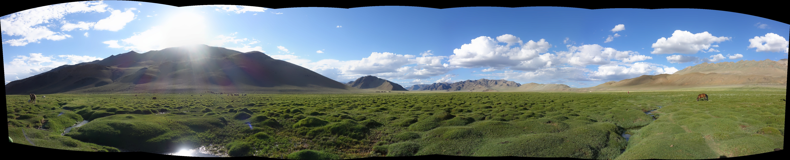

# Panorama Stitching with OpenCV

> 📚 **Course lab** – Computer Vision (FPT University Can Tho)

A small script that stitches a sequence of overlapping photos into a single panorama using OpenCV's `Stitcher`.



## How it works

1. Reads all images from the `image/` folder, sorted by the number in the file name (`1.jpg`, `2.jpg`, ...).
2. Creates an OpenCV stitcher in panorama mode (`cv2.Stitcher_create(cv2.Stitcher_PANORAMA)`), which internally detects and matches features, estimates the camera/homography transform and blends the images.
3. Saves the result to `panorama_result.jpg` and shows a resized preview.

The example result above was stitched from 8 overlapping photos.

## Getting started

```bash
git clone https://github.com/HuongPQ-w/opencv-panorama-lab.git
cd opencv-panorama-lab
pip install -r requirements.txt
```

Put your own overlapping photos (at least 2, named `1.jpg`, `2.jpg`, ...) into the `image/` folder, then run:

```bash
python panorama.py
```

Tips for good results: take photos from the same position while rotating the camera, keep 30–50% overlap between neighboring photos, and keep exposure similar.

## Tech stack

Python · OpenCV
